<div align="center">

# PVE Homelab

**Local graphical console for a Proxmox-powered home workstation**

Plug a monitor into your Proxmox VE host and get a beautiful sign-in screen, a live dashboard
of your homelab, your web services one click away, and a launcher that boots your desktop VMs
straight onto the GPU that monitor is wired to.


[Features](#features) · [Screenshots](#screenshots) · [Try it in 1 minute](#try-it-without-proxmox) · [Install](#install-on-a-proxmox-host) · [Configure](#configuration) · [Extend](#extending-it) · [Українською](README.uk.md)

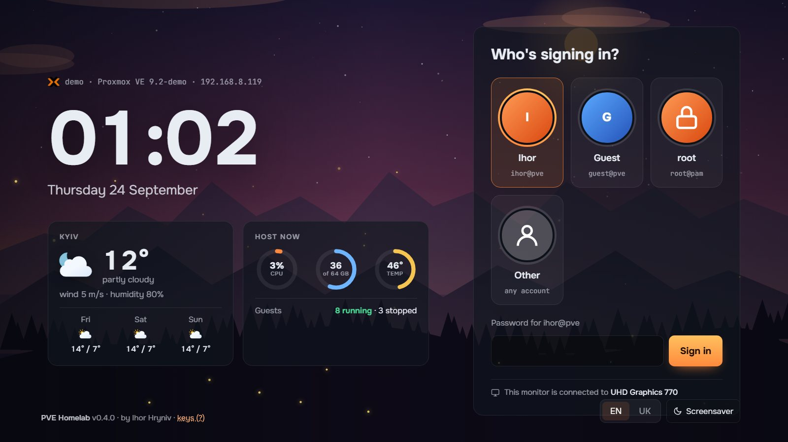

</div>

---

## Why

A Proxmox box under the desk is usually two things at once: a server for containers and VMs,
and the computer you actually sit at. Its own monitor, though, shows a black text console.

PVE Homelab turns that console into the front door of the machine:

- **Walk up, sign in** with your Proxmox account, and see what the host is doing.
- **Pick a system** (Windows for games, Linux for work) and it starts on *your* GPU. The monitor
  switches its input by itself, and when you shut the VM down it switches back to the menu.
- **Open any service** (Home Assistant, Jellyfin, Immich, Grafana and the rest) without
  bookmarks, because PVE Homelab finds them on its own.
- **Leave it**, and it turns into a calm, weather-aware screensaver.

No new accounts and no new permission model: everything runs with the Proxmox ticket of whoever
signed in, so each person sees and controls exactly what PVE allows them to.

## Features

### Sign-in and people
- **Proxmox users are the users.** Sign in with `user@pve` or `root@pam`. Every call to the PVE
  API uses that person's own ticket, so Proxmox permissions apply as they are.
- **Two-factor sign-in.** Accounts with a second factor in Proxmox get asked for it after the
  password: a code from the authenticator app (on a keypad the remote's arrows can reach, or typed),
  a recovery key, or a YubiKey. Security keys (WebAuthn) work only in the Proxmox web UI itself.
  Wrong answers are limited per name and per place (an address, or a screen on the host).
- **A visual user picker** with avatars. You choose who appears there and how it looks:
  compact avatars, a title line above the clock, "remember who signed in last", and an optional
  "someone else" tile.
- **Everything is per user:** language, theme, background, fonts, clock, widgets, order of
  systems and services, and weather city.
- **Interface, per user too:** size (80–160 %, for a TV across the room), a calm mode without
  animations, 12 or 24 hours, the date's form, which parts the dashboard shows, whether guest
  shutdowns ask first, and how long messages stay.

### Seats: one menu per GPU and monitor
- Every GPU the host drives with a monitor attached becomes a **seat** with its own menu and its
  own sign-in. A second GPU gives you a second, independent seat.
- The menu runs as a kiosk (`cage` + Chromium) on its own virtual terminal. The text console
  stays one keypress away on **Ctrl+Alt+F1**.

### Launch systems on your GPU
- VMs tagged `seat` in Proxmox appear as big cards at the top of the dashboard: one row,
  Netflix-style, that scrolls when there are more than four.
- **On a discrete GPU:** PVE Homelab assigns the GPU to the VM, starts it and switches the
  monitor input over **DDC/CI**. When the VM stops, the monitor comes back to the menu.
- **On the integrated GPU:** the VM starts with **VirGL** and its screen opens right inside the
  menu over a built-in noVNC relay. **Ctrl+Alt+Q** brings you back. What the VM's GPU entry said
  (`x-vga`, `romfile`, a mapping) and its display are kept, and the next start on a discrete GPU
  puts them back.
- Each step (assign GPU, start, switch monitor) shows as a clear checklist while it happens.
- GPUs given to VMs as Proxmox **resource mappings** (`hostpci0: mapping=…`, PVE 8+) are understood
  like plain PCI addresses. A VM that names a mapping keeps naming one when it gets another GPU, and
  writing a mapping needs `Mapping.Use` on it, as in Proxmox.
- **A VM started without the menu** (with the host, or from the Proxmox UI) on a GPU wired to the
  menu's monitor is watched too: the monitor comes back when it stops. One that starts while the host
  boots also gets the monitor; `launch.follow_start: always` does that for any start, `never` for none.

### Web services, found by themselves
Your services are collected from three places and merged:
1. **Caddy** (admin API): your real domain names.
2. **Open ports of containers**, read by the host straight from `/proc` without entering the
   guest, plus common web ports of VMs. Every candidate is checked with a `GET /`; only real
   HTML pages make the list, and the page title and container name decide the name and logo.
3. **Links in guest notes** in Proxmox (`[Grafana](http://10.0.0.5:3000)`).

Each tile shows whether its guest is up. Services open as **tabs next to the menu**, and a small
dock on every page (**Alt+Q**) takes you back. You can type to search, drag tiles to reorder them,
or sort by name or status.

### Containers and VMs
A compact list of every guest you're allowed to see, with state, CPU and memory, and start,
shut down, reboot and console where your rights allow it. A guest's row opens its history:
CPU, memory and network graphs for an hour, a day or a week, its snapshots and its last backup.

### Looks: themes, backgrounds, fonts, clocks
- **4 themes** (Dusk, Forest, Graphite, North) that recolour everything, including the landscapes.
- **14 backgrounds.** There is a live SVG landscape and six landscapes in pure CSS (Mountains, Sea,
  Dunes, Night city, Hills, Starry night). They all follow the **time of day** (the sun rises and
  sets, and at night the moon and stars come out) and the **weather** (clouds, rain, snow,
  lightning, fog, snow settling on the peaks). There are also six simple ones: gradient, aurora,
  dots, grid, theme and black.
- **14 fonts** with Cyrillic support, set separately for the interface and for the clock and headings.
- **6 clock designs:** digital, thin (with a seconds line), stacked, flip cards, analog and neon.
- **Previews that tell the truth.** Every theme, background and clock tile is a tiny monitor
  showing the real sign-in screen in that look. Hover it and it plays *clear → storm → night →
  dashboard windows*, with real rain and lightning.

### Widgets
Per-user widget columns for the sign-in screen and the dashboard, each with its own
settings form (⚙) and a live preview:

| Widget | Shows | Settings |
|---|---|---|
| Weather | now + forecast (Open-Meteo, no API key) | forecast days, wind and humidity |
| Host | CPU, memory and temperature rings, 30-minute CPU graph | which rings, graph |
| GPUs | which GPU drives which monitor, and which is free | |
| Clock | any clock design | design, date |
| World clock | several time zones | zones, 12-hour format |
| Calendar | this month | week start, week numbers |
| Countdown | days to an event | title, date |
| Guests | running VMs and containers with load | running or all, types, rows |
| Services | how many services are up, and which are down | list style |
| Network | traffic, address, load | fields |
| Storage | how full each storage is | which storages, used or free |
| Disks | SMART health and SSD wear of each disk, ZFS pools | only problems |
| Backups | guests without a recent backup | stale after how many days, guests to list |
| Wake up | Wake-on-LAN buttons for the machines in `wol:` | |
| Proxmox updates | packages waiting on the node, a new kernel, when the lists were checked | packages to list |
| Links | your own bookmarks, opened as tabs | links |
| Note | your text | heading, text |
| Quick actions | PVE web UI, screensaver, reboot, shut down | buttons |

**Your own widgets** sit next to these: `/etc/pve-homelab/widgets/<id>/widget.js` on the host
(updates leave it alone), or installed by an admin from *Settings → Dashboard → My widgets*.
`python3 tools/new_widget.py <id>` starts one in the demo; see [DESIGNS.md](DESIGNS.md#your-own-widgets).

### Screensaver
After a few idle minutes the sign-in screen dims into a big clock over the living landscape,
with the current weather and particle effects. Any key brings it back.

### Built for a keyboard, a remote, or a mouse
Arrow keys move like a TV remote: they always pick the nearest thing in the direction you press.
Tab never escapes an open dialog, and Esc closes it. Press **?** for the full list of keys.
A mouse works everywhere, but you never need one.

On a narrow screen (under 900 px: a phone, a tablet held upright, a small window) the menu
becomes one scrolling column with readable type: systems swipe sideways, guests turn into
cards, and settings and dialogs take the whole width.

### Runs itself
- **Updates from GitHub.** A badge in the top bar and a reminder after sign-in. Admins install it with one
  click, or switch on *Update by itself* in *Settings → About* for a nightly install. *Check now* there
  asks GitHub at once instead of waiting for the next check. No git is needed on the host.
- **Proxmox updates.** For those who may update the node, a button in the top bar counts the
  packages waiting; an amber dot means a new kernel is among them. Its dialog lists them, says when
  the package lists were last checked, checks again on request, and opens Proxmox, where they are
  installed (*Node → Updates → Upgrade*). It can be turned off in *Settings → Dashboard*.
- **Settings → System** (admins): every setting of the host, grouped and searchable: access,
  systems, web services, weather, alerts, Wake-on-LAN, updates. A change is kept in `settings.yaml`
  next to `config.yaml` and wins over it, takes effect at once (or offers the restart it needs), and
  goes back to the file in one click; `config.yaml` itself is never written.
- **Components.** Parts of the menu can be switched off for the whole host: the bell, Proxmox
  updates, updates of the menu, weather, consoles, guest actions, host power, Wake-on-LAN,
  installing designs and widgets. What is off leaves the menu and its API answers 404.
- **Alerts.** A bell in the top bar counts what needs a look, worst first: a failing disk or ZFS
  pool, a storage nearly full, a hot host, guests without a recent backup, a service whose guest is
  down. The limits are under `alerts:` in `config.yaml`.
- **Error journal.** Backend warnings and the screens' own errors (JavaScript, failed widgets,
  server errors) are collected in *Settings → About*, and also in `/var/log/pve-homelab/errors.log`.
- **Write to the author.** *Settings → About → Write to the author* composes a GitHub issue: a bug,
  an idea or a question, optionally with the versions and the latest errors (user, host and guest
  names and addresses taken out). Everything that would be sent is shown first; a QR code takes it
  to a phone to finish there, or it opens in a tab. Nothing leaves the host until you submit it on
  GitHub. `feedback: false` in `config.yaml` hides it.
- **English and Ukrainian.** A new language is one JSON file.

## Screenshots

<table>
<tr>
<td width="50%">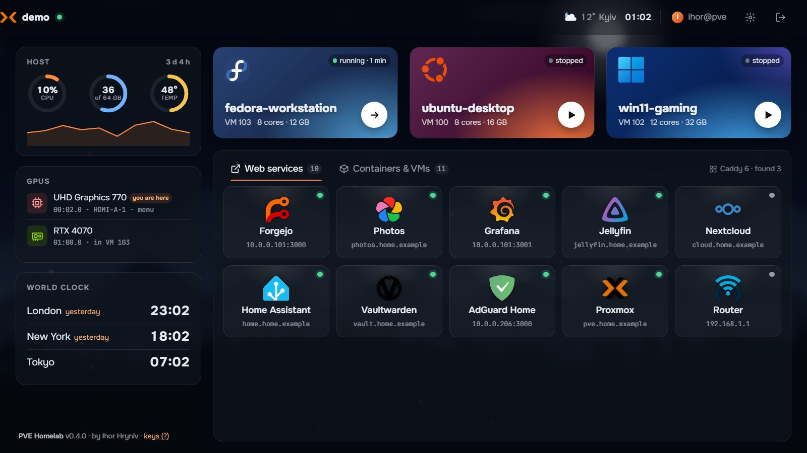<br><sub><b>Dashboard.</b> Systems on top, web services found automatically, host and GPU widgets, world clock.</sub></td>
<td width="50%">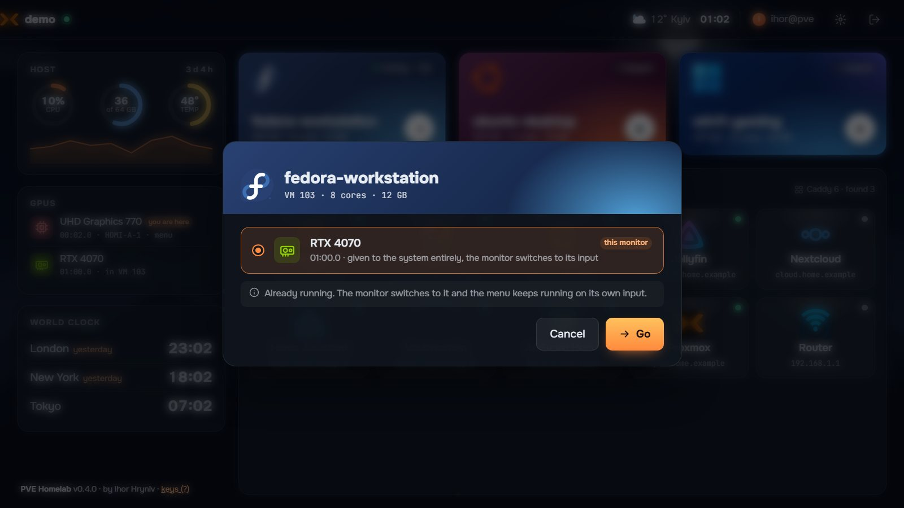<br><sub><b>Launch.</b> The GPU is assigned to the VM, the VM starts, the monitor switches its input.</sub></td>
</tr>
<tr>
<td>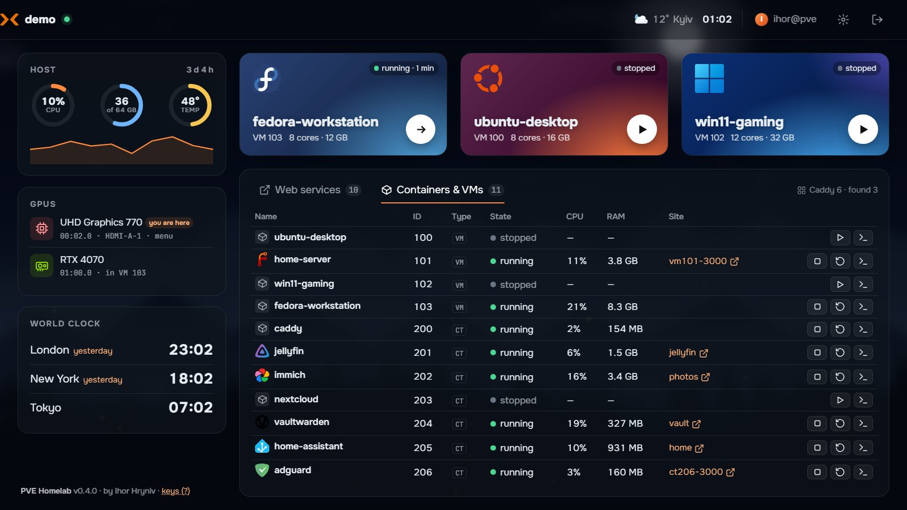<br><sub><b>Containers and VMs</b> with state, load and quick actions.</sub></td>
<td>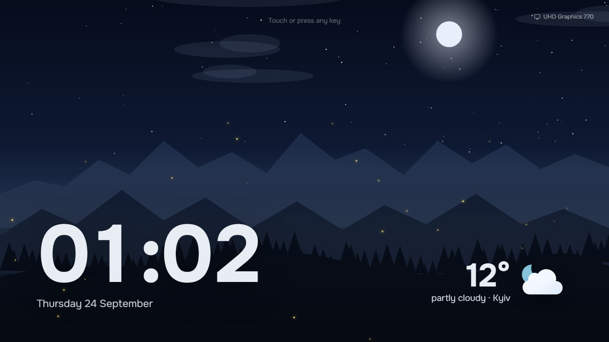<br><sub><b>Screensaver:</b> a big clock, the weather, and the landscape reacting to both.</sub></td>
</tr>
<tr>
<td>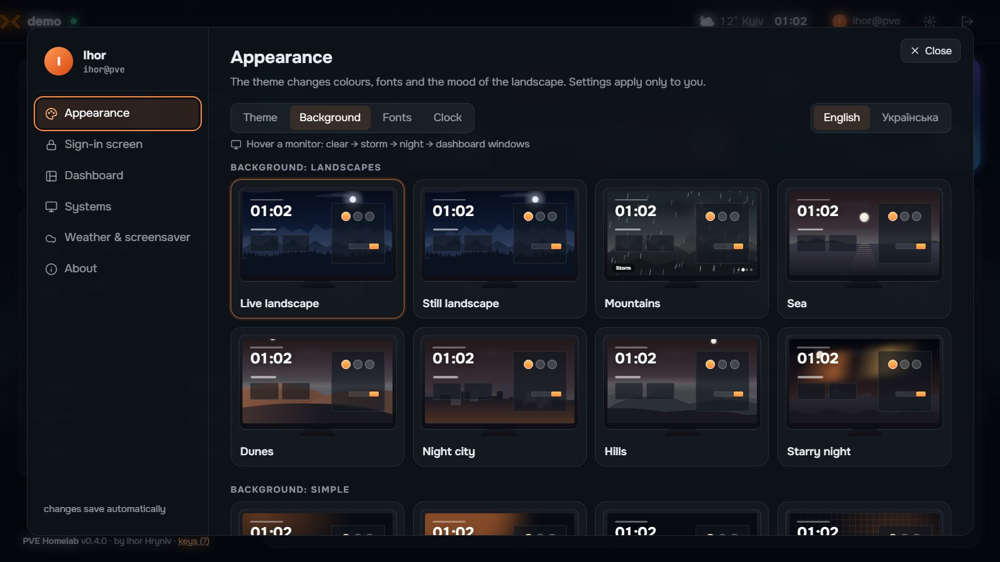<br><sub><b>Backgrounds.</b> Every tile is a tiny monitor; hovering plays clear → storm → night → windows.</sub></td>
<td>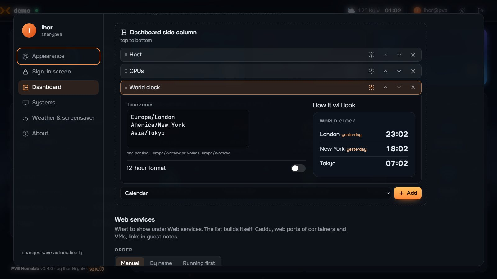<br><sub><b>Widgets.</b> A settings form for each, with a live preview.</sub></td>
</tr>
<tr>
<td>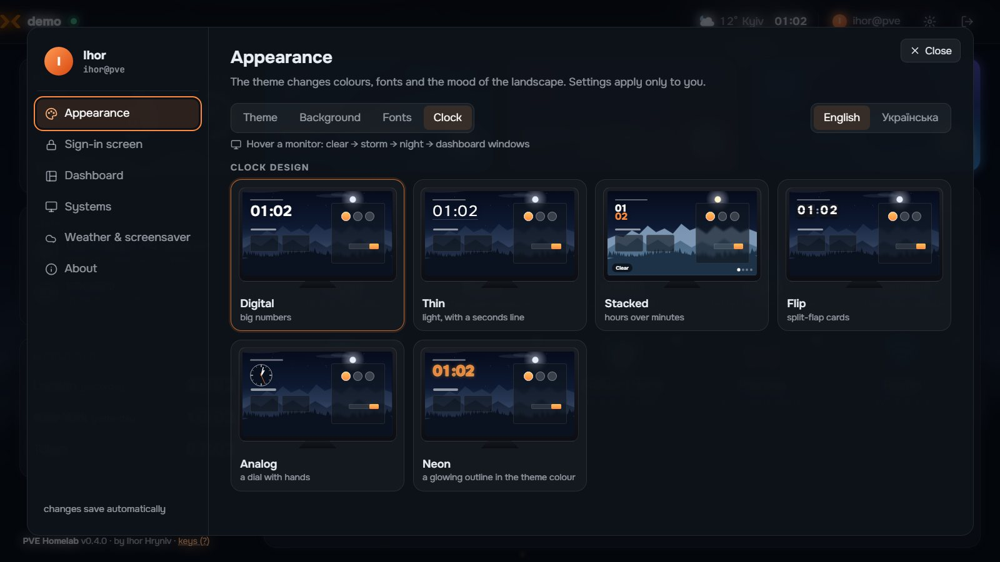<br><sub><b>Clock designs</b>, previewed on the real sign-in screen.</sub></td>
<td>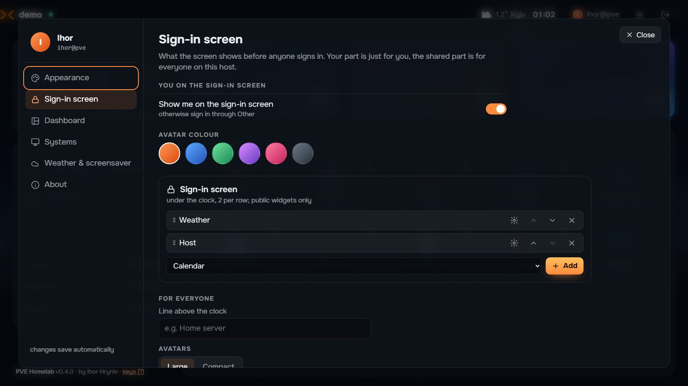<br><sub><b>Sign-in screen settings:</b> your own, and host-wide ones for admins.</sub></td>
</tr>
</table>

### One screen, many moods

Backgrounds follow the time of day and the real weather. Themes recolour them.

<table>
<tr>
<td width="50%">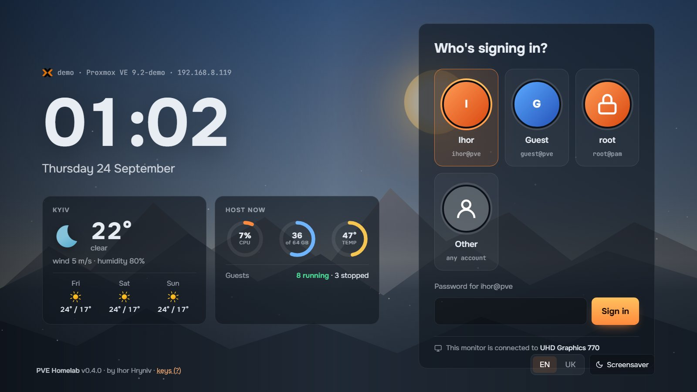<br><sub>Mountains · Dusk theme · day</sub></td>
<td width="50%">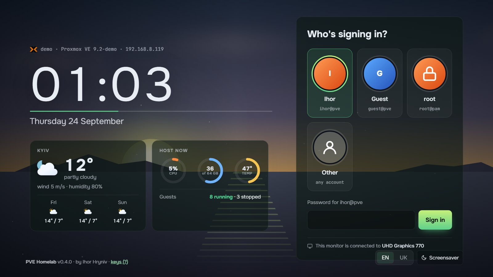<br><sub>Sea · Forest theme · dawn · thin clock</sub></td>
</tr>
<tr>
<td>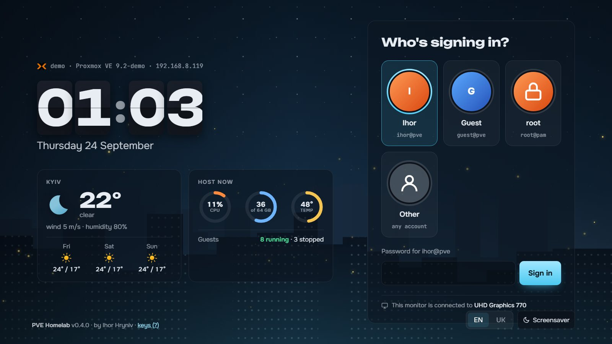<br><sub>Night city · North theme · night · flip clock</sub></td>
<td>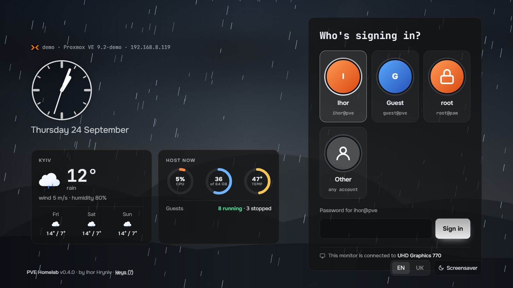<br><sub>Hills · Graphite theme · rain · analog clock</sub></td>
</tr>
<tr>
<td>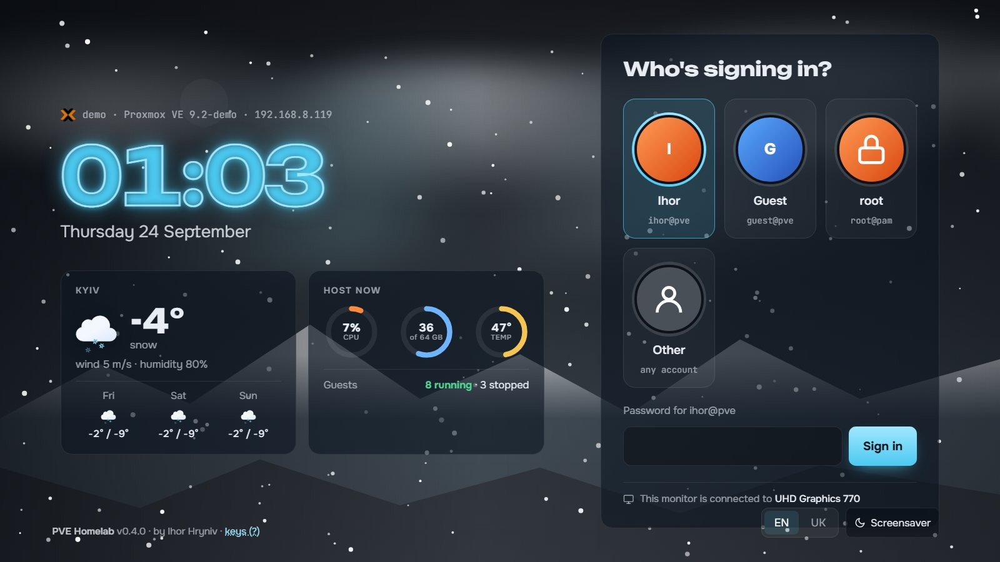<br><sub>Starry night · North theme · snow · neon clock</sub></td>
<td>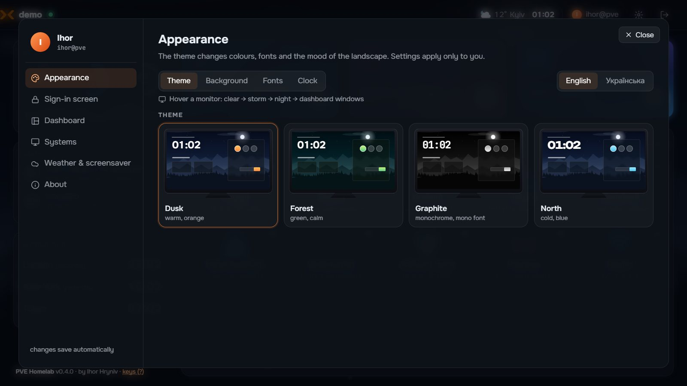<br><sub>Themes, each previewed with your background</sub></td>
</tr>
</table>

## Try it without Proxmox

The demo runs the **real** app over a made-up host with 4 VMs, 7 containers, two GPUs and a
handful of services. Nothing real is touched. All you need is Python 3.10+.

| System | Do this |
|---|---|
| **Windows** | double-click `demo.bat` |
| **Linux / macOS** | `./demo.sh` |

The first start takes about a minute: it prepares `.demo/` and installs two libraries. Then
**http://127.0.0.1:8900** opens by itself. Pick **Ihor**, **Guest** (limited rights) or **root**,
type **any password**, and explore.

The diagonal **DEMO** ribbon in the corner opens a panel that adds pretend systems and services
(through Caddy, a container port or guest notes), changes the weather and fakes an available update.

Options: `--lang en|uk`, `--port 9000`, `--no-browser`.

## Install on a Proxmox host

Requirements:
- **Proxmox VE 8 or 9.**
- **A monitor** on a GPU the host itself uses (the integrated one is fine). Without one, install
  just the backend with `--no-kiosk`.
- **Internet** on the host, for apt packages, the weather and service logos.
- **Optional:** Caddy with its admin API on `localhost:2019`, and monitors with DDC/CI for input switching.

As root on the host:

```bash
git clone https://github.com/gryniv/pve-homelab.git /root/pve-homelab
cd /root/pve-homelab
./install.sh
```

The installer:
1. installs `cage`, `chromium`, `ddcutil`, `python3-aiohttp`, `python3-yaml`;
2. creates the system user `pvehomelab` for the kiosk;
3. copies the program to `/opt/pve-homelab`;
4. on the first run, detects your hardware and writes `/etc/pve-homelab/config.yaml`: GPUs with
   monitors, DDC monitors and their inputs, the Caddy container, and a weather city from your time zone;
5. enables `pve-homelab` (the backend on `127.0.0.1:8900`) and `pve-homelab-kiosk@<seat>` (the menu
   on tty7, tty8, …).

Installer options: `--no-kiosk`, `--city Lviv`, `--lang en|uk`.
Your config and user settings are never overwritten by a re-install or an update.

The text console stays on **Ctrl+Alt+F1** and the menu is on **Ctrl+Alt+F7**. `./uninstall.sh`
removes it, the kiosk's browser profiles (with the services' cookies) included; your settings in
`/etc/pve-homelab`, the packages and the `pvehomelab` user stay.

> **Upgrading from PVE Seat 0.3** (the old name) is automatic: `install.sh` moves
> `/etc/pve-seat` to `/etc/pve-homelab`, keeps a copy as `/etc/pve-seat.migrated`, and replaces
> the old units and kiosk user.

## Configuration

After installing:

1. **Systems.** Tag a VM `seat` in Proxmox and it appears in the menu. VMs you can't tag (for
   example ones hibernated to disk) go into `systems_extra: [100]`.
2. **A discrete GPU on the same monitor.** Add its input to `monitors`. The input codes come from
   `ddcutil capabilities | grep -A8 'Feature: 60'`:
   ```yaml
   monitors:
     mon0:
       ddc_bus: 4
       inputs:
         "0000:79:00.0": 0x11   # HDMI-1: the menu (integrated GPU)
         "0000:02:00.0": 0x0f   # DisplayPort-1: the GPU for VMs
   ```
3. **Web services.** Most are found automatically. To add one by hand, write it into the guest's
   notes (`[Name](http://address:port)`) or under `links:`. To hide one, add it to `discovery.ignore`
   or switch it off in the menu settings.
4. **The menu in a browser elsewhere** (a phone, a laptop) goes through your reverse proxy with TLS,
   never straight to port 8900. Let the backend listen beyond loopback and name the proxy:
   ```yaml
   listen: 0.0.0.0:8900
   web:
     allow_from: [192.168.8.150]   # the Caddy container; an address or a network
   ```
   and proxy a site to it in Caddy (`reverse_proxy 192.168.8.146:8900`). Everyone else beyond
   loopback gets 403. A browser that comes through the proxy is the **web seat**: it never switches
   a monitor or hands over a GPU; a system opens right in the browser (noVNC) or starts on the GPU
   it already has. Before signing in it shows a name field, the weather and clocks: no people, no
   host figures (`web.sign_in: users` lists the people, `full` shows everything, as on the host).
   Signed in, everyone sees only the guests, services and GPUs their Proxmox rights allow.
   `web: {enabled: false}` turns this off.
5. **Wake-on-LAN.** Machines the *Wake up* widget can switch on go under `wol:`; whoever presses
   the button needs `Sys.PowerMgmt` on the node:
   ```yaml
   wol:
     - {name: NAS, mac: "aa:bb:cc:dd:ee:ff"}
   ```
6. Apply the changes with `systemctl restart pve-homelab 'pve-homelab-kiosk@*'`.

Every option is explained in [`etc/config.example.yaml`](etc/config.example.yaml).

### Updates

The menu checks GitHub every few hours: the latest release, else the highest `vX.Y.Z` tag, or the
newest commit of a branch with `channel: main`. When there is something new:

- an **"Update vX.Y.Z"** badge appears in the top bar, with a reminder after sign-in;
- anyone with `Sys.Modify` on `/` installs it with one click;
- *Settings → About → Update by itself* (admins), or `update.auto: true`, installs new versions
  every night around 04:30, or right after the host is switched on if it was off then. The menu's
  switch is kept in `/etc/pve-homelab/update-settings.json` and wins over `config.yaml`.

An update can't leave the host with a broken menu:

- the tag is resolved to its commit first, and the archive of exactly that commit is installed;
- the new version is put in place next to the old one, which stays as `/opt/pve-homelab.prev`;
- if the menu doesn't come back running the new commit within a minute, the old version is put
  back (the failed one is kept as `/opt/pve-homelab.failed` for a look);
- the outcome is saved in `/etc/pve-homelab/update-result.json`, and an admin who signs in after
  a failed update is told once.

```yaml
update:
  repo: ""          # owner/name; empty = where it was cloned from, else gryniv/pve-homelab
  channel: release  # release | main
  auto: false
  auto_main: false  # with channel main, auto installs any pushed commit only if this is true
```

By hand: `./update.sh` in the clone, or `PYTHONPATH=/opt/pve-homelab/backend python3 -m pvehomelab.update check|apply`.

## Keys

| Where | Keys |
|---|---|
| Menu | arrows move · Tab / Shift+Tab · Enter · Esc closes · **?** shows all keys |
| Dashboard | just type to search services · **Alt+← →** moves a tile or a system |
| An open service | **Alt+Q** shows the dock (← → pick, Enter, Esc back) |
| A VM screen inside the menu | **Ctrl+Alt+Q** goes back to the menu (the VM keeps running) |
| Host | Ctrl+Alt+F1 text console · Ctrl+Alt+F7 the menu |

## Extending it

Everything visual is a **drop-in file**. The backend finds it, and its name comes from the file's
first comment, one `@key` per line (`@name.en …`, `@name.uk …`, `@order 10`). It shows up in the
settings, with a live preview.

**Designs** (how it looks) live apart from the program, in `designs/`. Your own go to
`/etc/pve-homelab/designs/<kind>/` on the host: updates never touch that folder, and a file there
with the same id as a built-in design replaces it.

*Settings → Look* is a grid of designs, each opening like a folder: inside are its own settings
(say, its colour, font or layout), the background, the clock and the fonts, and every design
remembers how each person wore it. A theme that brings its own background and clock is one pack in
*My designs*, removed with one click.

**Making designs** — scaffolding, live reload in the demo, the showcase page and every contract: [DESIGNS.md](DESIGNS.md).

| Design | File | Contract |
|---|---|---|
| Theme | `designs/themes/<id>.css` | only tokens (`--acc`, `--acc2`, `--glass`, `--solid`, `--display`, `--lf` …) |
| Background | `designs/backgrounds/<id>.css` | `@group scape\|flat`; paint `.bgx[data-k="<id>"]` and layers `.l1`–`.l4` from the `--sky1..3 --far --mid --ink` palette. The engine adds sun, moon, stars, clouds, fog and weather |
| Clock | `designs/clocks/<id>.js` | `export const css` + `export function render(el, {h, m, s, text})`, called every second |
| Font | `designs/fonts/<id>.css` | `@family "Name", sans-serif` in the header + an `@import` of the web font |
| Widget look | `designs/widgets/<id>.css` | styles for `.A .w[data-w="<id>"]`; the widget's logic stays in `web/widgets/<id>/` |

The program's own extension points:

| Module | File | Contract |
|---|---|---|
| Widget | `web/widgets/<id>/widget.js`, yours in `/etc/pve-homelab/widgets/<id>/widget.js` | `zones`, `public`, `source`, `every`, `options`, `render(data, ctx)`, `after(el, data, ctx)`; its strings in `<id>/i18n/<lang>.json` |
| Language | `web/i18n/<code>.json` | the same keys as `en.json`, plus `"_name"` |

A widget with settings looks like this, its strings apart from the code:

```js
// widgets/network/widget.js
export default {
  zones: ['side', 'login'],          // where it may be placed
  public: true,                      // allowed on the sign-in screen
  source: '/api/host', every: 5,     // data and refresh interval (s)
  options: [                         // gets a ⚙ form and a live preview in Settings
    { key: 'graph', type: 'toggle', label: 'opt_graph', default: true },
  ],                                 // toggle · select · checks · number · text · date · list · textarea
  render: (h, { t, opts }) => `<h4>${t('title')}</h4>${opts.graph ? '…' : ''}`,
};
```

```json
// widgets/network/i18n/en.json (and uk.json, or any other language)
{ "title": "Network", "opt_graph": "Graph" }
```

## How it works

```
backend/pvehomelab/  aiohttp on 127.0.0.1:8900: Proxmox API with the user's ticket, host stats,
                     GPUs and DDC/CI, Caddy + port + notes discovery, weather, launcher,
                     noVNC relay, updater, error journal, demo world
web/                 the UI, plain ES modules with no build step: core/, widgets/, i18n/,
                     vendor/novnc
designs/             how it looks, apart from the program: themes/, backgrounds/, clocks/,
                     fonts/, widgets/ (widget styles); yours in /etc/pve-homelab/designs/
kiosk/               kiosk.sh (cage + Chromium on the seat's GPU), an MV3 extension for service
                     tabs and the Alt+Q dock, Chromium policy (system DNS)
systemd/             pve-homelab.service, pve-homelab-kiosk@.service, pve-homelab-update.{service,timer}
tools/               dryrun.py (a safe backend next to the real one), screenshots.py (layout checks
                     at 10 resolutions), readme_shots.py (the pictures above), new_design.py and
                     new_widget.py (start a design or a widget of your own)
demo.py              the real app over an in-memory fake host
```

## Development

Tests and checks run anywhere, no Proxmox needed: the backend is tested through the demo.

```bash
pip install -r requirements-dev.txt
python -m pytest -q                         # backend: unit tests and the HTTP API
python3 tools/check_web.py                  # front end: JS syntax, same i18n keys in every language
python tools/ui_check.py --start-demo       # the menu in a headless Chrome: ~30 checks, about a minute
```

`ui_check.py` signs in, clicks and types like a person on the demo (guest actions, sign-out,
widgets, alerts, launching, consoles, settings, keyboard) and fails on any JavaScript error.
`--only alerts,launch` runs a few; without `--start-demo` it uses a demo already running on :8900.

GitHub Actions runs all of it on every push (Python 3.10 to 3.13), plus `shellcheck` on the scripts.

On the host, next to the real service:

```bash
python3 tools/dryrun.py --port 8901        # real data, password "test", actions only logged
python3 tools/launch_plan.py 102           # what starting VM 102 would change (qm set, monitor input), nothing done
python3 tools/screenshots.py --out /tmp/shots --lang en
```

`screenshots.py` walks through sign-in, the dashboard, guests, launch and settings at 10 common
resolutions, from 1024×768 up to 3840×2160 and 3440×1440. It reports horizontal scrolling,
off-screen elements and clipped text.

To regenerate the README pictures from the demo:

```bash
python demo.py --no-browser &
python tools/readme_shots.py --browser "/path/to/chrome"
```

For DevTools on the kiosk's Chromium, set `kiosk.debug_port: 9222` (it listens on 127.0.0.1 only).

## Troubleshooting

- **Logs:** `journalctl -u pve-homelab -u 'pve-homelab-kiosk@*' -f`
- **Error journal:** *Settings → About → Error journal*, for users with `Sys.Audit`. The file is
  `/var/log/pve-homelab/errors.log`: JSON lines, rotated, up to 4 MB.
- **Services fail with "connection refused".** Their names must resolve to internal addresses.
  The kiosk uses the host's DNS (`/etc/resolv.conf`).
- **The monitor doesn't switch.** Check `ddcutil detect` and the codes under `monitors`. Some
  monitors (Dell P2418D, for example) always report the same input, so PVE Homelab only switches
  the input and never reads it back.
- **The menu on a discrete NVIDIA GPU.** The host can only draw on it with a driver that supports
  it. An RTX 50 series card with nouveau needs the GSP firmware for its chip.

## Status

PVE Homelab is **0.x**: it is used daily on a real homelab, but config keys and APIs may still
change between minor versions. Issues and ideas are welcome.

## License

[GPL-3.0](LICENSE). You may use, study, change and share PVE Homelab; changed versions you distribute stay under the same license.

## Credits

Built by **[Ihor Hryniv](https://github.com/gryniv)**.

Third-party: [noVNC](https://github.com/novnc/noVNC) (MPL-2.0), vendored in `web/vendor/novnc` ·
weather icons: [Meteocons](https://github.com/basmilius/weather-icons) by Bas Milius (MIT) ·
service logos: [homarr-labs/dashboard-icons](https://github.com/homarr-labs/dashboard-icons), fetched at runtime ·
weather data: [Open-Meteo](https://open-meteo.com) · fonts: Google Fonts (OFL) ·
kiosk: [cage](https://github.com/cage-kiosk/cage) + Chromium.

Proxmox® is a registered trademark of Proxmox Server Solutions GmbH. This project is not affiliated
with or endorsed by Proxmox Server Solutions GmbH.
